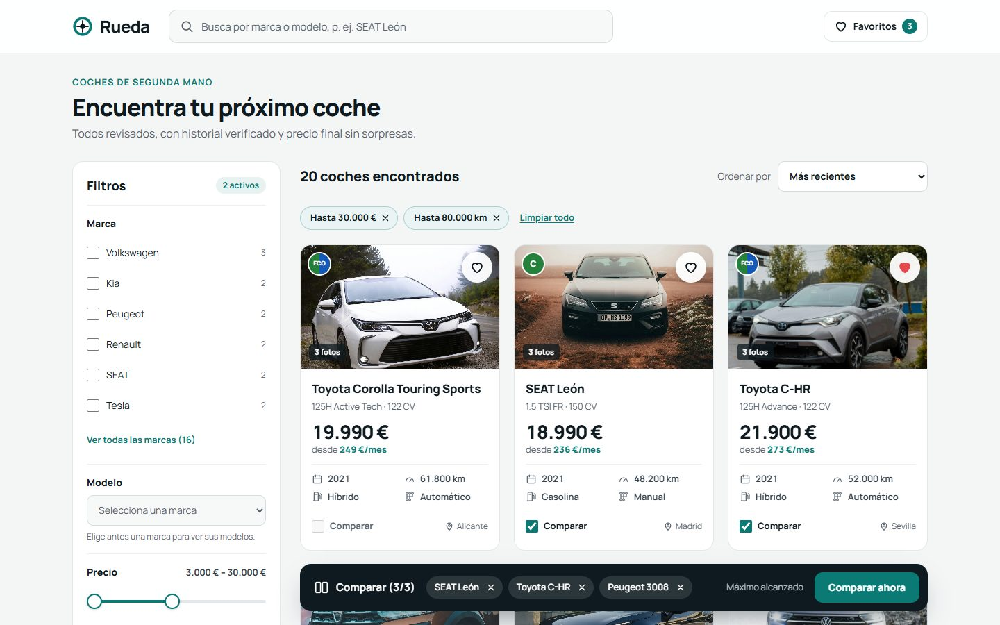
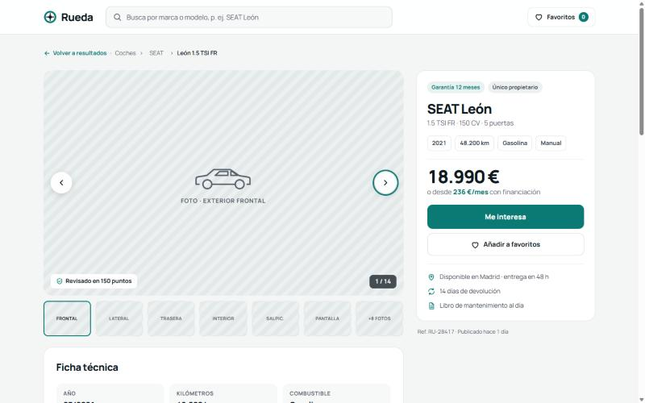
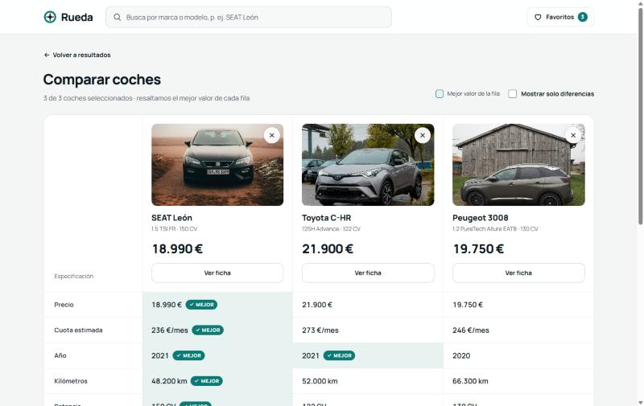
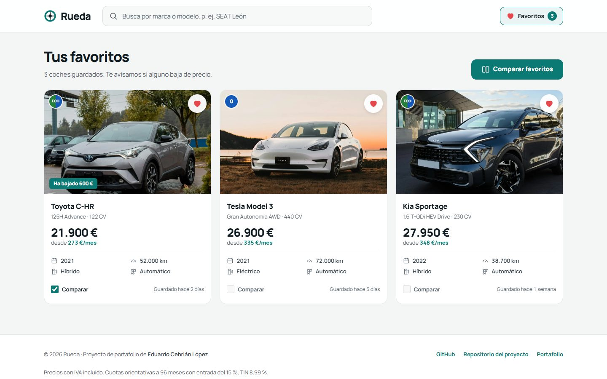
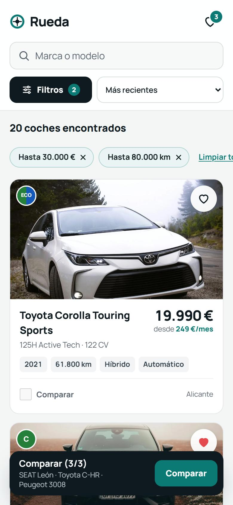
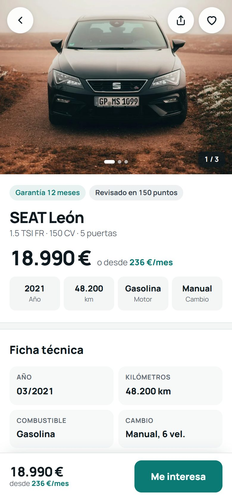

# Rueda

Buscador de coches de segunda mano para el mercado español: listado con filtros, ficha con galería y
calculadora de financiación, comparador de hasta tres coches y favoritos. Es un proyecto de portafolio
construido como si fuera a salir a producción: diseño aprobado de partida, accesibilidad AA, estado
compartible por URL, fotos reales con licencia libre y tests de la lógica y de los flujos principales.

Proyecto de portafolio de **Eduardo Cebrián López** ([GitHub](https://github.com/tioeduardo93)).

**Pruébala en línea:** https://rueda-eduardo-cebrian.netlify.app/



## Pantallas

| | |
| --- | --- |
|  |  |
| **Ficha.** Galería con miniaturas, flechas y teclado; ficha técnica, equipamiento, calculadora de cuota y coches similares. | **Comparador.** Hasta 3 coches, el mejor valor de cada fila resaltado y opción de ver solo las diferencias. |
|  |   |
| **Favoritos.** La misma tarjeta del listado, con «Guardado hace…» y «Ha bajado X €». | **Móvil.** Filtros en un panel inferior, ficha con la foto a todo el ancho y barra fija con el precio. |

- **Listado (`/`)**: búsqueda por marca, modelo o versión (sin tildes ni orden de palabras), filtros por marca, modelo,
  precio, año, kilómetros, combustible, cambio y etiqueta DGT, chips de filtros activos, cinco órdenes y «Cargar más».
- **Ficha (`/coche/:id`)**: galería, ficha técnica, equipamiento, calculadora (entrada y plazo) y coches parecidos.
- **Comparador (`/comparar`)**: tabla con cabeceras de fila y columna, «Mejor» por fila y «solo diferencias».
- **Favoritos (`/favoritos`)**: guardados en el navegador, con casilla para mandarlos al comparador.
- Estados de carga (esqueletos), error con reintento, vacío y página 404 en todas las pantallas.
- Fotos reales de cada modelo (frontal, lateral o trasera e interior) y vista previa al compartir el enlace
  (Open Graph y Twitter Card); cada ficha actualiza el título y la meta description.

## Stack

| | Por qué |
| --- | --- |
| **Vite + React 18 + TypeScript estricto** | Arranque y recarga instantáneos; `strict` y `noUncheckedIndexedAccess` evitan los `undefined` que no se ven venir. |
| **Tailwind CSS 4** | Los colores, radios y sombras del diseño son tokens (`bg-accent`, `rounded-card`), no valores sueltos repartidos por el código. |
| **React Router 7** | Rutas, `useSearchParams` para el estado en la URL y restauración del scroll. La versión 8 exige React 19. |
| **Zustand** | Favoritos y comparador en dos stores pequeños, persistidos en `localStorage` sin código propio. |
| **Vitest + Testing Library + axe-core** | Tests que usan la app como un usuario (roles y nombres accesibles) y comprobación automática de accesibilidad. |
| **Manrope autoalojada** | La tipografía del diseño sin peticiones a terceros. |
| **sharp** (solo desarrollo) | Convierte las fotos originales a WebP de 1200×800 y menos de 150 KB con un script reproducible. |

## Decisiones técnicas

**La URL es la única fuente de verdad del listado.** Filtros y orden se leen de la URL y se escriben en ella
(`?marca=SEAT&precioMax=30000&orden=precio-asc`). Una búsqueda se puede compartir, sobrevive a la recarga y el
botón «Atrás» deshace un filtro sin ningún estado duplicado. Lo que llega por la URL se valida en `lib/url.ts`: los
valores fuera de rango se ajustan, lo desconocido se ignora y la URL se reescribe limpia. Los filtros discretos
añaden una entrada al historial; escribir o arrastrar un slider la sustituye, para no llenarlo.

**La lógica vive en funciones puras, fuera de los componentes.** Filtrar, ordenar, generar los chips, decidir el
«Mejor» de cada fila del comparador o elegir los coches similares son funciones de `src/lib/` sin React. Por eso se
prueban con tests sencillos y las reutilizan la barra lateral y el panel móvil por igual. Los componentes de
`src/components/` solo pintan lo que reciben; los de `src/containers/` los conectan con los stores.

**Toda la financiación sale de `lib/finance.ts`.** Condiciones únicas (96 meses, entrada del 15 %, TIN 8,99 %,
sistema francés) para la cuota «desde» de las tarjetas, la calculadora y el comparador. La cuota «desde» se calcula
con la misma entrada con la que abre la calculadora, así que las dos cifras coinciden por construcción. Un test
recorre el catálogo para asegurarlo y comprueba las cuotas del diseño (SEAT León, 236 €/mes).

**Formatos propios.** `Intl.NumberFormat('es-ES')` no agrupa los números de cuatro cifras (da `8990`), así que
`lib/format.ts` formatea a mano: `18.990 €` y `45.000 km`, con espacio de no separación antes de la unidad.

**Accesibilidad AA.**
- Botones y enlaces reales, `aria-label` en los botones de icono y foco siempre visible con contraste 3:1.
- Áreas táctiles de al menos 44 px; donde el diseño pide algo más pequeño, la zona pulsable se amplía sin cambiar
  el aspecto.
- Un solo `h1` por pantalla, landmarks completos y `aria-live` donde cambian resultados, cuotas o fotos.
- La comparativa es una `<table>` con `caption` y `<th scope>`.
- El panel de filtros en móvil es un `<dialog>` modal: atrapa el foco, se cierra con Escape y devuelve el foco al
  botón que lo abrió.
- Al quitar un coche del comparador o un favorito, el foco pasa al elemento siguiente en vez de perderse.
- Se respeta `prefers-reduced-motion`.
- axe-core se ejecuta como test sobre todas las pantallas y estados.

**Persistencia mínima y tolerante.** Favoritos y comparador se guardan en `localStorage` (`rueda:favoritos`,
`rueda:comparador`) con el middleware `persist` de Zustand: solo los ids y la fecha de guardado, nunca copias de los
coches, así que los precios siempre salen del catálogo vigente. Si un coche desaparece del catálogo, su id se limpia
solo y los contadores no lo cuentan.

**Fotos servidas por la propia app.** Las 74 fotos están en `public/cars/<id>-<n>.webp` (1200×800, ≤150 KB, 74 KB de
media): no dependen de que Unsplash o Pexels sigan sirviendo la imagen. `scripts/photos.json` es la única fuente:
de ahí `npm run photos` descarga los originales, los convierte y genera `src/data/photos.ts` y `CREDITS.md`. Todas
llevan `width`/`height` (sin saltos de maquetación), `loading="lazy"` salvo la primera visible, un fondo mientras
cargan y un texto alternativo descriptivo («SEAT León negro, vista frontal»).

**Un solo panel de filtros.** `containers/ListingFilters.tsx` decide con una media query si pinta la barra lateral
(escritorio) o el panel inferior (móvil): nunca están los dos en el DOM, y hay un solo selector de orden. Los textos de
las opciones viven en `lib/filters.ts`.

**Un mismo marcado para móvil y escritorio.** Cada pantalla cambia de disposición con Tailwind (la ficha y el
listado en 1024 px) en lugar de mantener dos versiones. Las rutas declaran en su `handle` si traen cabecera propia
en móvil o una barra fija abajo, y el layout se adapta; la fila «Filtros / Ordenar» del listado se pinta dentro de
la cabecera fija mediante un portal.

**Tests sin tiempos.** La API simulada responde con 500 ms de retardo para que se vean los esqueletos, pero en los
tests el retardo es 0: los tests esperan a que aparezca algo en pantalla, nunca a que pase un tiempo.

## Cómo arrancarlo

Requiere Node 22.12 o superior (o Node 24), que es lo que piden Vite, Vitest y jsdom. El dominio de producción
(para las URLs absolutas de Open Graph) se cambia en `.env` (`VITE_SITE_URL`); autor y enlaces, en `src/config/site.ts`.

```bash
npm install
npm run dev       # servidor de desarrollo en http://localhost:5173
npm run build     # comprobación de tipos y build de producción en dist/
npm run preview   # sirve el build de producción
npm test          # todos los tests (Vitest)
npm run lint      # ESLint, con reglas de accesibilidad (jsx-a11y)
npm run photos    # regenera las fotos, src/data/photos.ts y CREDITS.md desde scripts/photos.json
```

En desarrollo, `/componentes` muestra el catálogo de componentes base y tokens.

## Estructura

```
src/
├── routes.tsx · App.tsx    Rutas de la app (las mismas que usan los tests de flujo)
├── config/site.ts          Dominio, autor y enlaces del pie (un solo sitio para cambiarlos)
├── index.css               Tokens del diseño y utilidades (fondo de foto, esqueleto, slider doble)
├── types.ts                Tipos Car y Photo y sus uniones
├── data/cars.ts            Catálogo de 24 coches del mercado español
├── data/photos.ts          Vistas de las fotos de cada coche (generado por scripts/build-photos.mjs)
├── lib/                    Lógica pura: format, finance, filters, url, compare, car, api simulada
├── store/                  Zustand persistido: favoritos y comparador
├── hooks/                  Catálogo, estado del listado en la URL, media queries, limpieza de ids retirados
├── components/             Presentacionales: Button, FilterChip, DgtBadge, CarCard, RangeSlider, CompareBar,
│   │                       EmptyState, BottomSheet…
│   ├── filters/            Controles de filtro compartidos por la barra lateral y el panel móvil
│   ├── detail/             Galería, ficha técnica, calculadora, resumen…
│   └── compare/            Tabla del comparador
├── containers/             Conectan componentes con stores y lógica
├── layout/                 Layout, cabecera, pie y huecos que rellenan las páginas
├── pages/                  Listado, ficha, comparador, favoritos y 404
└── test/                   Setup, flujos completos, accesibilidad con axe y utilidades
public/cars/                Fotos de los coches en WebP (créditos en CREDITS.md)
scripts/                    photos.json (fotos, autores y notas) y build-photos.mjs
design/                     Diseño aprobado de partida (pantallas de escritorio y móvil)
```

## Límites conocidos

- **API simulada.** Los datos salen de `src/data/cars.ts` con un retardo artificial; no hay backend. Las fechas de
  publicación se desplazan para que el catálogo parezca reciente cuando se abra.
- **Fotos del modelo, no del coche.** Son fotos libres de cada modelo, no de la unidad anunciada. Cuando no había
  fotos libres del modelo exacto se ha usado uno parecido o una generación anterior; `CREDITS.md` lo indica en cada caso.
- **«Me interesa» no envía nada.** Muestra la confirmación del diseño, sin formulario ni servidor.
- **Favoritos y comparador por navegador.** Se guardan en `localStorage`; no hay cuentas de usuario.
- **Filtrado en local.** Con 24 coches basta; con un catálogo real, el filtrado y la paginación irían al servidor
  con los mismos parámetros de URL.

## Créditos

Fotos de [Unsplash](https://unsplash.com) y [Pexels](https://www.pexels.com) bajo sus licencias libres; el autor y el
enlace de cada una están en [CREDITS.md](CREDITS.md).
